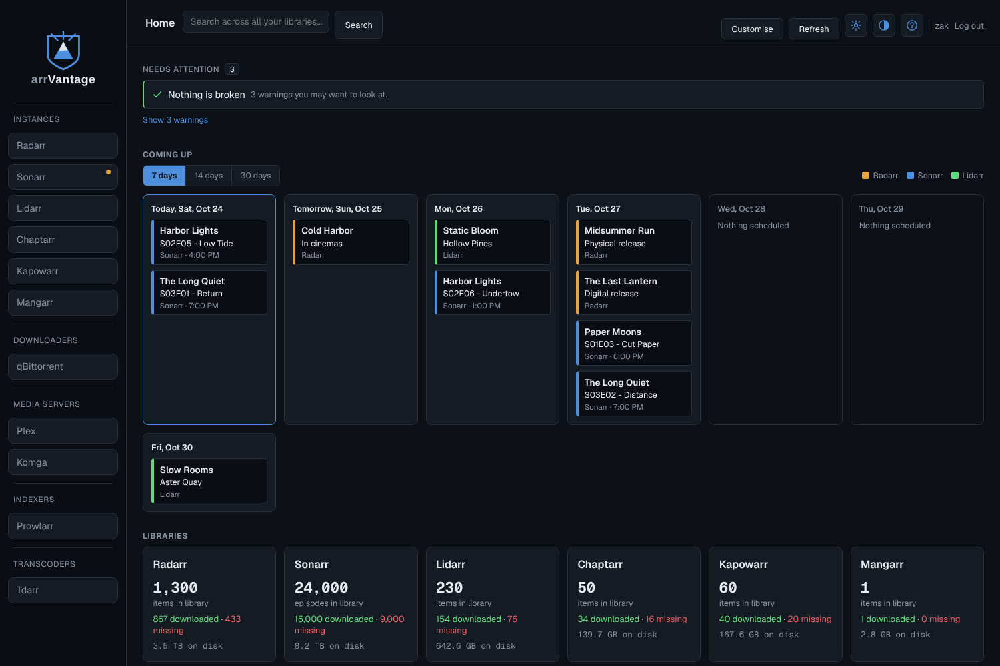

# arrVantage

> A unified web frontend for your media automation stack — arr apps, indexers, Seerr, media servers, metadata providers, and transcoders, all in one place.

   



## Status

Actively developed — expect rough edges and breaking changes between releases. Pin a specific image tag rather than tracking `latest` if you want stability.

## Features

- Unified dashboard for your \*arr stack (Sonarr, Radarr, Lidarr, Readarr (Tested with Bookshelf and then Chaptarr), Kapowarr)
- **Needs attention** on Home: stalled or failed downloads, unreachable apps and services, health warnings and low disk space, merged so the same problem is shown once. Warnings you do not care about can be hidden; outages cannot
- **Coming Up** on Home: the next 7, 14 or 30 days of episodes (Sonarr), movie releases (Radarr), albums (Lidarr) and books (Readarr / Chaptarr), colour-coded with each instance's own colour, and each instance's name above the calendar switches it off and on (remembered in your browser) if one of them is too busy
- **Service history** and **push alerts**: arrVantage checks your stack in the background, records when each service went down and came back, and can tell you by ntfy, Discord, Telegram, email, Slack, Pushover, Gotify or a webhook (see [Alerts and service history](#alerts-and-service-history))
- **Downloads** on Home: a card per download client (qBittorrent, SABnzbd) with its speed, whether it is downloading, waiting, paused or idle, and the few downloads that are actually moving with progress and time left. It refreshes itself every 10 seconds while Home is open
- Indexer visibility (Prowlarr)
- Request management via Seerr (Overseerr / Jellyseerr / Seerr)
- Media server status (Plex / Jellyfin / Emby / Komga), plus BookOrbit (uptime check, and with an API key a browsable library view)
- Metadata lookups (TMDB / TVDB / Fanart.tv)
- Transcode status (Tdarr)
- Your own Home: drag the panels, and the cards inside them, into the order you want, and hide the ones you do not use. It is saved per user
- Eleven themes and a choice of accent colours, also per user
- Several users, with an administrator role and separate permissions for requesting and searching
- **Backup and restore** from Settings, and a **Copy diagnostics** button for bug reports (see below)
- One small container, no database: everything lives in a single `config.json`

## Getting Started

**Just want to run it?** Use the quick install below.

**Want to fork it, customize it, or build your own image?** See [SETUP.md](SETUP.md) for the full walkthrough — forking the repo, the automatic build pipeline, deployment on a generic Docker host or TrueNAS specifically, and a complete reference table of where to find every integration's API key.

## Installation

arrVantage is also available as an app in the TrueNAS SCALE community catalog. Everywhere else it is a single Docker container. The image is built for amd64 (Intel and AMD) and arm64 (Raspberry Pi, Apple silicon, ARM servers), and Docker picks the right one by itself. Each release's arm64 build is started and asked for `/health` in GitHub's automated build before it is published, but it has not been run on real ARM hardware, so please report anything odd:

```bash
docker run -d \
  --name arrvantage \
  -p 5000:5000 \
  -v /path/to/config:/app/data \
  ghcr.io/kazwahs/arrvantage:latest
```

Or with `docker-compose.yml`:

```yaml
services:
  arrvantage:
    image: ghcr.io/kazwahs/arrvantage:latest
    pull_policy: always
    container_name: arrvantage
    ports:
      - "5000:5000"
    volumes:
      - /path/to/config:/app/data
    environment:
      - CONFIG_DIR=/app/data
      - FORCE_HTTPS_COOKIES=false
      # - LOG_LEVEL=DEBUG   # uncomment while troubleshooting
    restart: unless-stopped
```

Then open `http://<your-server>:5000` and connect your services (API URLs + keys) from the settings page. There is an initial setup wizard that will run for you to set up your admin account.

## Configuration

| Variable | Description | Default |
|---|---|---|
| `CONFIG_DIR` | Where `config.json` (instances, users, API keys) is read from and written to inside the container. Must point at your mounted volume, or settings won't survive a restart. | `/app/data` |
| `FORCE_HTTPS_COOKIES` | Set to `true` once your reverse proxy + SSL certificate are confirmed working end-to-end, to make the login cookie HTTPS-only. Leave `false` for plain local-network HTTP access. | `false` |
| `PORT` | The port arrVantage listens on inside the container. If you change it, change the right-hand side of the port mapping to match. | `5000` |
| `LOG_LEVEL` | How much arrVantage writes to its log: `WARNING` (default), `INFO`, `DEBUG` or `ERROR`. See [Logs](#logs) below. | `WARNING` |
| `MONITOR_INTERVAL` | Seconds between background checks, which feed the service history and the alerts. `0` switches them off (Needs attention is then only checked while the dashboard is open). Anything from 30 to 3600. | `60` |

## Logs

arrVantage writes its log to the container's standard output, so there is no log file to find or clean up: use `docker logs arrvantage` (add `-f` to follow it live), or the **Logs** view of the app in TrueNAS.

By default it is quiet and only reports things that need attention: a call to one of your services that failed (the service's host and path, plus the HTTP status or the kind of connection error), a Settings **Test** that failed, a failed sign-in, and a `config.json` that could not be read. A service that stays down is reported once every five minutes rather than every few seconds.

If something misbehaves, set `LOG_LEVEL=DEBUG` and restart the container; every call arrVantage makes to your services is then listed, with the status and how long it took. Please include those lines when you open an issue.

API keys, tokens, passwords and query strings are never written to the log, so the lines are safe to paste into an issue. They do contain the addresses of your servers (for example `192.168.1.20:8096`), so blank those out if you would rather not share them.

## Alerts and service history

arrVantage runs the same checks as **Needs attention** in the background, every 60 seconds by default, whether or not anyone has the dashboard open. A problem only counts once it has been seen on two checks in a row, and only counts as over after two clear ones, so one slow answer neither raises an alarm nor ends an outage.

- **Service history.** On Home, **Needs attention → History** lists when each service went down and came back, how long it lasted, and any outage that is still going. The last 90 days are kept in `history.json` next to `config.json`. It holds only service names and times, and you can delete it whenever you like.
- **Push alerts** (**Settings → Alerts**, administrators only). Each administrator sets up their own destinations and chooses what to hear about: *Outages and critical problems only* (the default: a service that stops answering, every indexer failing, a critically low disk) or *Everything, warnings included* (warnings you have hidden on Home stay quiet). You get one message when a problem starts and one when it clears. If a lot breaks at once, such as a switch going down, you get a single summary instead of a flood. **Send a test alert** checks the setup.
  - **ntfy:** the server (the public `https://ntfy.sh` or your own), a topic, and an access token only if your server needs one. On the public server anyone who knows the topic can read it, so make it hard to guess.
  - **Discord:** a channel's webhook address (in Discord: channel settings, Integrations, Webhooks, create one, Copy Webhook URL). Each alert is one message with a coloured side bar and the severity written in its footer (Critical, Warning or Resolved), plus the services involved. Alerts never ping anyone, even if a service is called `@everyone`. Only `discord.com` webhook addresses are accepted. Discord can't read the generic webhook's message, which is why it has its own box.
  - **Telegram:** a bot of your own. In Telegram, message `@BotFather`, send `/newbot`, answer its questions and copy the token. Open your new bot and send it any message (for a group, add the bot to the group and write something there), then paste the token into arrVantage and press **Find my chat**: it lists the chats the bot has seen and fills in the chat ID when you pick one. Each alert is a short message with the title in bold and the severity and services underneath.
  - **Email:** your mail server's name, the security option (STARTTLS on port 587 is the usual one; SSL/TLS on 465; *None* only for a mail server on your own network), an optional login and password, a From address and up to five addresses to send to. Gmail, Yahoo and most other providers need an app password instead of your normal one. The subject says what happened (for example `[arrVantage] Critical: Radarr can't be reached`) and the body gives the details. If the mail server's certificate is not one a normal browser would trust (a self-signed one), the alert will fail with "the certificate was not accepted".
  - **Slack:** an incoming webhook. In Slack, create an app for your workspace (api.slack.com/apps), switch on *Incoming Webhooks*, add a webhook to the channel you want and copy its address (`https://hooks.slack.com/services/...`). Each alert is one message with the title in bold and the severity and services underneath. Slack's own markup is escaped, so a service called `<!channel>` cannot ping anyone. Only `hooks.slack.com` addresses are accepted (on GovSlack, use the generic webhook below).
  - **Pushover:** your user key (on the Pushover home page) and the API token of an application you create on pushover.net. A critical problem is sent as high priority, which can get through your phone's quiet hours; a warning is normal priority and a recovery is low priority (no sound).
  - **Gotify:** the address of your own Gotify server and the token of an application created on its *Apps* tab (arrVantage has to be able to reach that address from where it runs). A critical problem is sent at a higher Gotify priority than a warning or a recovery. The text is sent as plain text.
  - **Webhook:** arrVantage sends a JSON `POST` to the address, for Home Assistant, n8n and the like:

    ```json
    {"app": "arrVantage", "version": "1.6.0", "event": "opened", "title": "Radarr can't be reached",
     "message": "Connection refused", "severity": "critical", "kind": "unreachable",
     "services": ["Radarr"], "since": "2026-11-01T10:00:00Z", "ended": null}
    ```

    `event` is `opened`, `cleared` (with `ended` filled in) or `test`.
- The topic, access token, webhook addresses (Discord's and Slack's included), Telegram bot token and chat ID, the Pushover keys, the Gotify token, and the email login, password and addresses are treated like API keys: they are left out of exports unless you tick *Include API keys*, are never sent back to your browser once saved, and are never written to the log (a failed alert is logged as, for example, `HTTP 500`, without the address).
- The alerts are sent by the arrVantage container, so it must be able to reach your ntfy server, Discord, Telegram (`api.telegram.org`), Slack (`hooks.slack.com`), Pushover (`api.pushover.net`), your Gotify server, your mail server or your webhook address from where it runs.
- Set `MONITOR_INTERVAL=0` to turn the background checks, the history and the alerts off.

## Backup, restore and diagnostics

Everything is under **Settings → Backup, restore and diagnostics** (administrators only).

- **Export settings** downloads your configuration as a JSON file. By default the file leaves out API keys and password hashes, so it is safe to share or keep in a repository. Tick *Include API keys and password hashes* for a full backup, and treat that file like a password.
- **Restore from a file** shows exactly what a file would change before anything happens. Confirming it first saves your current settings next to `config.json` as `config.backup-<date>.json` (the newest ten are kept), then replaces them. A file exported without keys keeps the keys and accounts you already have set up. Your session key is never exported or replaced.
- **Copy diagnostics** puts a summary of your setup on the clipboard for a bug report: the version and build, the versions of its main libraries, which kinds of services you run (counts only), whether the monitor and alerts are on, and the latest warnings. It never contains API keys, passwords, usernames or the names you gave your services, and server addresses are hidden unless you untick the box.

## Why arrVantage?

I run the full \*arr stack, Seerr, a media server, and a transcoder, and every time I needed to check on one I had a browser tab open for each. What started as a batch file that just launched all those tabs at once slowly turned into the idea for a proper unified frontend — one place to see and manage everything instead of tab-hopping between five different UIs.

## A Note on How This Was Built

I'm in my mid-40s, work more than full-time, and have a family — I don't have the spare hours to learn a new stack from scratch right now. So I built arrVantage with Claude's help rather than writing every line by hand. Full transparency on that: the architecture decisions, the debugging, and the ongoing maintenance are mine, but a lot of the code itself came out of that collaboration. It's working well for me, and I'd rather ship something useful than wait until I had time to do it "the traditional way."

It's still evolving — I'm actively using it myself and tweaking it as I go. Feel free to try it out, and open an issue if something breaks or you'd like to see a feature added.

## Supported Integrations

| Category | Supported |
|---|---|
| \*Arr apps | Radarr (movies), Sonarr (TV), Lidarr (music), Chaptarr / Readarr-style book managers, Kapowarr (comics), Librarr (manga and books fetcher: a Search tab with a Manga / Ebooks / Audiobooks choice that sends the result you pick, its queue with Retry for failed jobs, history, and the files it has imported grouped by title) |
| Indexers | Prowlarr — indexer health status, individual and bulk testing |
| Downloaders | qBittorrent, SABnzbd |
| Requests | Overseerr, Jellyseerr |
| Media servers | Plex, Jellyfin, Emby — Now Playing, Recently Added, Watch History, Users, library rescan. Komga for comics and manga libraries. BookOrbit for ebooks, comics and audiobooks: arrVantage checks that it is up (it needs no token, just its address), warns you on Home and in the alerts when it is not, and links to it. With an API key (BookOrbit 3.8 or newer, Read access is enough) you can pick a library, search it and page through its books with covers, open any book to see its authors, series, description, publisher, ISBN, genres and files, and see what was added lately |
| Activity data | Tautulli and/or Tracearr, for richer Now Playing / Watch History / Users than the media servers' own APIs provide alone |
| Metadata | TMDB, TVDB, Fanart.tv, TheAudioDB |
| Transcoding | Tdarr — stats overview, space saved, per-node worker/queue status |

## Roadmap

What exists today, and what is on the list. The unchecked items are ideas, not promises, and the order is not a schedule.

- [x] Needs attention, with hideable warnings
- [x] Themes and accent colours
- [x] A Home you can rearrange
- [x] Coming Up calendar
- [x] Settings backup and restore, and copyable diagnostics
- [x] Push alerts (ntfy, Discord, Telegram, email, Slack, Pushover, Gotify or a webhook) when something breaks, so you do not have to have the dashboard open
- [x] A short history of when each service went down and came back
- [x] The version shown in the About panel and in diagnostics
- [x] Discord alerts
- [x] Telegram and email alerts
- [x] Slack, Pushover and Gotify alerts
- [x] A Downloads panel on Home: qBittorrent and SABnzbd speeds and active queue in one place
- [x] Book releases in Coming Up (Readarr / Chaptarr). Built from Readarr's published API; please report it if Chaptarr answers differently
- [x] BookOrbit: uptime check, alerts and a link; with an API key (BookOrbit 3.8+) a Library tab (pick a library, sort, search, open any book for its details) and Recently Added
- [x] Librarr as an instance: Library (the manga, ebooks and audiobooks it has imported, grouped by title, with a Type filter), Queue with Retry, History, System, a Search tab with a Manga / Ebooks / Audiobooks choice that sends the result you pick, and a card in Home's libraries panel (built from its README and a real 1.5.0 server; only the failed-job shape was seen live, so please report anything it shows wrongly)
- [x] Book and comic apps: Readarr, Chaptarr, Librarr, Komga, Kapowarr and BookOrbit are covered

## Contributing / Feedback

Issues and feature requests are welcome at [github.com/Kazwahs/arrvantage/issues](https://github.com/Kazwahs/arrvantage/issues) — this is very much a living project.

If something is not working, the most useful things you can include are the output of **Copy diagnostics** (Settings → Backup, restore and diagnostics) and the container's log. arrVantage logs to the container's standard output (`docker logs arrvantage`, or the Logs view of the app in TrueNAS) and only reports problems by default; set `LOG_LEVEL=DEBUG` and reproduce the problem to see every call it makes. API keys and passwords are never written to the log.

Pull requests are welcome too. For anything bigger than a small fix, please open an issue first so we can talk it through.

## License

Licensed under the [GNU General Public License v3.0](LICENSE) — the same license used by Sonarr, Radarr, and Prowlarr. In short: you're free to use, modify, and redistribute arrVantage, but any distributed modified version must also be open source under GPLv3.

## Acknowledgments

Built with the help of [Claude](https://claude.ai).